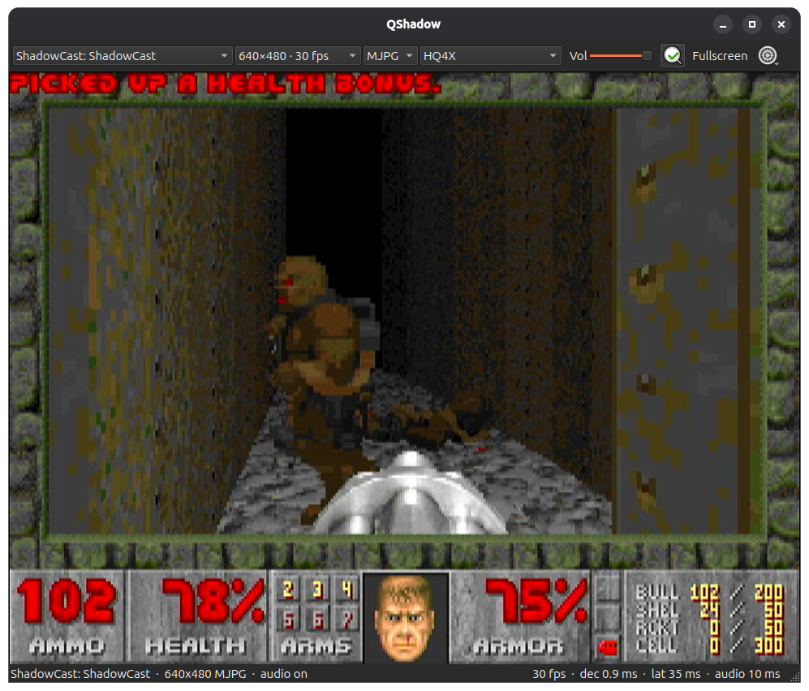

# QShadow

Minimal-latency viewer for USB video capture devices on Linux (Wayland) and
Windows 10/11. It was originally developed for the **GENKI ShadowCast** HDMI
capture dongle (`298f:1996`, the reference device) and now works with any UVC
capture card or webcam.

QShadow shows the device's video in a window and plays its audio through your
speakers, adding as little delay as possible.



## Features

- **Any capture device** — all video capture devices are listed in the *Device*
  selector (the choice is remembered). The audio interface of the same USB
  device is paired automatically; devices without audio run video only.
- **Formats** — MJPG, YUYV, UYVY, NV12 and RGB24/BGR24/BGRX (Windows: MJPG,
  YUY2, NV12, UYVY). Pick *Resolution* and *Format* in the toolbar, *Frame rate*
  in the Options menu. MJPG reaches high resolutions and rates; uncompressed
  formats are artifact-free but limited by USB bandwidth (on the ShadowCast,
  YUYV tops out at 720×480 @ 30 fps). H.264 is not supported.
- **Low latency** — capture and decode run on their own threads; MJPG and
  full-range BT.601 YUYV are converted to RGB on the GPU, other formats on the
  CPU. Frames are dropped rather than queued, and the audio buffer stays short.
- **Audio** — captured at the device's native rate, resampled to 48 kHz stereo,
  with a ±0.5% drift correction against the host sound card. The *Audio source*
  option picks the device's own audio, none, or any other input.
- **Shaders** — None, Bilinear, HQ4X, xBRZ, CRT-Geom, CRT-Royale and AMD FSR 1.0
  (several quality tiers), plus a *Downscale* option (×2/×4) for sources that
  were already upscaled.
- **Hotplug** — plug or unplug the device at any time; capture reconnects.
- **Remembers your settings** — window, device, format, resolution, frame
  rate, audio source, volume, shader and downscale.

## Requirements

- Linux with a **Wayland** session, or Windows 10/11 (x64)
- Qt 6 (`Core`, `Gui`, `Widgets`, `Multimedia`), libjpeg-turbo
- A Vulkan 1.1-capable GPU driver
- Linux: ALSA

On Ubuntu/Debian:

```
sudo apt install qt6-multimedia-dev libjpeg-turbo8-dev libasound2-dev \
                 libvulkan-dev libwayland-dev libegl-dev libgles-dev \
                 libdrm-dev libgbm-dev
```

Shaders are compiled at build time if `glslc` or `glslangValidator` is found;
otherwise the committed SPIR-V in `shaders/spv/` is used.

## Build and run

Linux:

```
cmake -B build -DCMAKE_BUILD_TYPE=Release
cmake --build build -j
ctest --test-dir build --output-on-failure   # no capture device needed
./build/qshadow
```

Windows (Visual Studio 2022+, CMake, [vcpkg](https://github.com/microsoft/vcpkg);
dependencies come from `vcpkg.json`, the first configure builds Qt and is slow):

```
set VCPKG_ROOT=C:\Dev\vcpkg
cmake --preset windows
cmake --build --preset windows-release
ctest --preset windows-release
build-windows\Release\qshadow.exe
```

## Using QShadow

- **Device / Resolution / Format** — choose the device, then the video mode
  matching your source (e.g. `1920×1080` for a 1080p source). *Format* appears
  when the device offers several. The status bar shows what was negotiated.
- **Options menu** (also the right-click menu) — frame rate, preserve aspect,
  audio source, downscale and other settings.
- **Shader** — *None* is nearest-neighbor (least smoothing); HQ4X/xBRZ suit
  clean low-res sources; CRT-Geom/CRT-Royale emulate a CRT; FSR 1.0 upscales
  and sharpens.
- **Downscale** — if the capture chain upscaled a low-res picture to a fixed
  size, set the matching factor so shaders work on the real pixel grid.
- **Status bar** — left: device, size, format, audio state. Right: frame rate,
  decode time, latency, audio buffer. Problems show as a red warning; hover for
  details. `QSHADOW_STATS=1` prints full numbers to stderr.

## Other devices

The ShadowCast is the device tested most; others use what the driver reports.

- **Colours** — YCbCr is converted with the matrix (BT.601/709) and range
  (full/limited) the driver declares. If colours look wrong (too dark or washed
  out), the device probably declares them incorrectly; such cases are fixed in
  `src/devicequirks.h` (the ShadowCast's YUYV is one). Reports with the device
  name, `lsusb` ID and the symptom are welcome.
- **Audio** — negotiated with the sound card (S16, mono or stereo, common rates).

## Troubleshooting

- **“Waiting for a video capture device”** — check the device is plugged in
  (`v4l2-ctl --list-devices`) and your user can open `/dev/video*` (`video`
  group).
- **“no supported video format”** — the device offers only unsupported formats
  (e.g. H.264).
- **No video** — make sure the source is powered on.
- **No sound** — check the host output volume and the *Audio source* option.

## CI and releases

GitHub Actions (`.github/workflows/`) builds, tests and packages on Linux and
Windows: `ci.yml` (push to `master`, PRs) and `release.yml` (tags `v*`) both
call the reusable `build.yml`. Release assets: Windows ZIP, Linux AppImage,
Linux tar.gz and `SHA256SUMS`. The Vulkan loader, ALSA, EGL/GL/gbm/drm and
`libwayland-*` are deliberately not bundled.

To release:

```
scripts/bump-version.sh 0.3.0           # CMakeLists.txt + vcpkg.json
git commit -am "release v0.3.0"
git push origin HEAD                    # merge to master through a PR first
git tag v0.3.0 && git push origin v0.3.0
```

The tag must match the versions in `CMakeLists.txt` and `vcpkg.json` (a suffix
like `-rc1` publishes a prerelease). The first Windows build on `master` takes
about 2.5 h (vcpkg builds Qt); later runs use the cache.

## License

QShadow is Copyright (C) 2026 Guillaume Millet and released under the
**GNU General Public License, version 3** (see [LICENSE](LICENSE)).

It includes third-party code under compatible licenses (AMD FidelityFX FSR,
xBRZ, CRT-Geom, hq4x) and links Qt 6 (LGPL-3.0) and libjpeg-turbo; see
[THIRD_PARTY_NOTICES.md](THIRD_PARTY_NOTICES.md), [shaders/ATTRIBUTION.md](shaders/ATTRIBUTION.md)
and [licenses/](licenses/). This software is based in part on the work of the
Independent JPEG Group.

QShadow is an independent project and is not affiliated with, endorsed by or
supported by GENKI. "GENKI" and "ShadowCast" are trademarks of their owner and
are used only to identify the hardware it was developed for.
